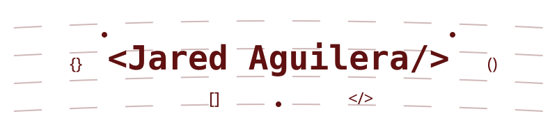

  <!-- main banner -->
  

  <!-- animated line divider -->
  

   

  <!-- typing svg title -->
  

  <!-- short bio -->
  

    Passionate about web development, backend systems, artificial intelligence, and automation. 
    Building practical solutions that automate processes and solve real-world problems.
  

  <!-- social links -->
  

    
  

  <!-- status badges -->
  

    
    
  

 

<!-- section divider line -->

  

 

<!-- about me section -->

<h1 style="border-bottom: none;"> 🌙 About Me </h1>

 

  I'm a <b>Software Engineering Student</b> passionate about backend development, automation, and artificial intelligence. I enjoy building practical tools that automate workflows and solve real-world problems.

<ul>
  <li>⚡ <b>Currently learning:</b> Advanced backend architecture and system design.</li>
  <li>🚀 <b>Building:</b> Personal automation tools and full-stack web applications.</li>
  <li>🎵 <b>Beyond coding:</b> I love listening to music, it keeps me focused and inspires my creative process.</li>
</ul>

 

<!-- section divider line -->

  

 

<!-- tech stack section -->

<h1 style="border-bottom: none;">🛠️ My Tech Stack</h1>

  <h4>Languages</h4>
  

    
    
    
    
    
    
    
    
    
  

  <h4>Databases</h4>
  

    
  

  <h4>Tools & Environment</h4>
  

    
    
    
    
  

  

<!-- footer -->

  

